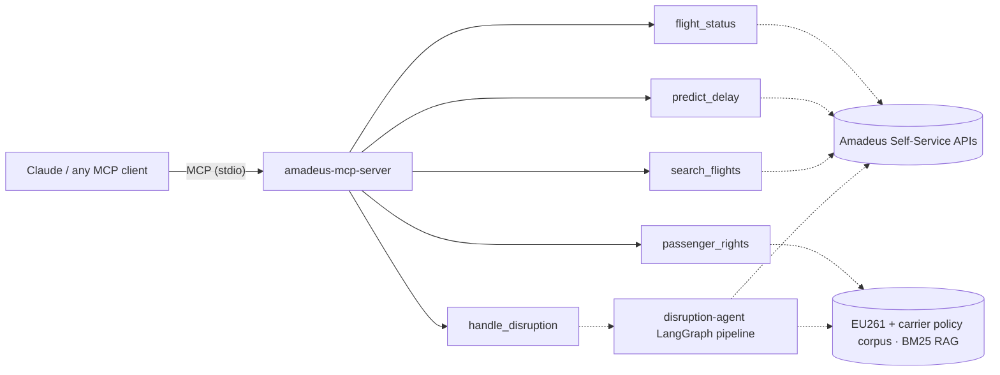

# 🛰️ Amadeus MCP Server

[](https://github.com/Thaynabarreiro/amadeus-mcp-server/actions/workflows/ci.yml)
[](https://www.python.org/)
[](LICENSE)

An open-source **[Model Context Protocol](https://modelcontextprotocol.io) server** that
exposes the [Amadeus Self-Service APIs](https://developers.amadeus.com) as tools for
Claude and any MCP client. Ask Claude *"Is AF1234 delayed tomorrow? What are my
rights?"* and it answers with real flight data and cited passenger-rights passages.

## Tools

| Tool | Backing source | What it does |
|---|---|---|
| `flight_status` | Amadeus On-Demand Flight Status | Scheduled vs estimated times, delay minutes, cancellation flag |
| `predict_delay` | Amadeus Flight Delay Prediction | P(delay > 2h) for a flight |
| `search_flights` | Amadeus Flight Offers Search | Bookable non-stop offers with prices and seats left |
| `passenger_rights` | RAG corpus (EU261, carrier policies) | Policy passages with **named sources** — no un-cited entitlements |
| `handle_disruption` | [amadeus-disruption-agent](https://github.com/Thaynabarreiro/amadeus-disruption-agent) | Runs the full LangGraph disruption pipeline and returns the grounded passenger message + trace |

## Architecture



All five tools are backed by the [`disruption-agent`](https://github.com/Thaynabarreiro/amadeus-disruption-agent)
package — one shared data layer for OAuth2, response normalisation, mock/live parity
and the policy corpus. The two projects compose: this server is the **interface**
(any MCP client becomes a travel assistant), the agent is the **automation**
(proactive end-to-end disruption handling).

## Quickstart

### Claude Code

```bash
claude mcp add amadeus -- uvx --from git+https://github.com/Thaynabarreiro/amadeus-mcp-server amadeus-mcp-server
```

Or from a local clone:

```bash
git clone https://github.com/Thaynabarreiro/amadeus-mcp-server
cd amadeus-mcp-server
python -m venv .venv && source .venv/bin/activate && pip install -e .
claude mcp add amadeus -- $(pwd)/.venv/bin/amadeus-mcp-server
```

### Claude Desktop

Add to `claude_desktop_config.json`:

```json
{
  "mcpServers": {
    "amadeus": {
      "command": "/path/to/amadeus-mcp-server/.venv/bin/amadeus-mcp-server",
      "env": { "AGENT_MODE": "mock" }
    }
  }
}
```

### Try it

No credentials needed — the default **mock mode** replays realistic fixtures. Ask Claude:

> *"Check the status of AF1234 tomorrow. If it's disrupted, what are my rights under EU261, and what rebooking options exist?"*

> *"Run the disruption handler for AF1234 tomorrow and show me the passenger message."*

### Live mode

Set environment variables (free test keys at [developers.amadeus.com](https://developers.amadeus.com)):

```json
"env": {
  "AGENT_MODE": "live",
  "AMADEUS_CLIENT_ID": "...",
  "AMADEUS_CLIENT_SECRET": "..."
}
```

## Design notes

- **Grounded by construction** — `passenger_rights` returns passages *with sources*,
  so the model can cite EU261 or carrier policy instead of asserting entitlements
  from memory.
- **Mock/live parity** — mock fixtures mirror live response shapes; switching modes
  changes the data source, not tool behaviour. That makes the server testable in CI
  and demoable anywhere.
- **Thin server, shared core** — tools delegate to the `disruption-agent` package;
  OAuth2 token caching, normalisation and retrieval logic live in one repository.

## Development

```bash
pip install -e ".[dev]"
pytest          # 8 offline tests: tool behaviour + MCP protocol registration
ruff check src tests
```

---

Built by [Thayná Barreiro](https://www.linkedin.com/in/thaynabarreiroqs) · MIT License.
*Not affiliated with Amadeus IT Group; uses the public Amadeus for Developers Self-Service APIs.*
